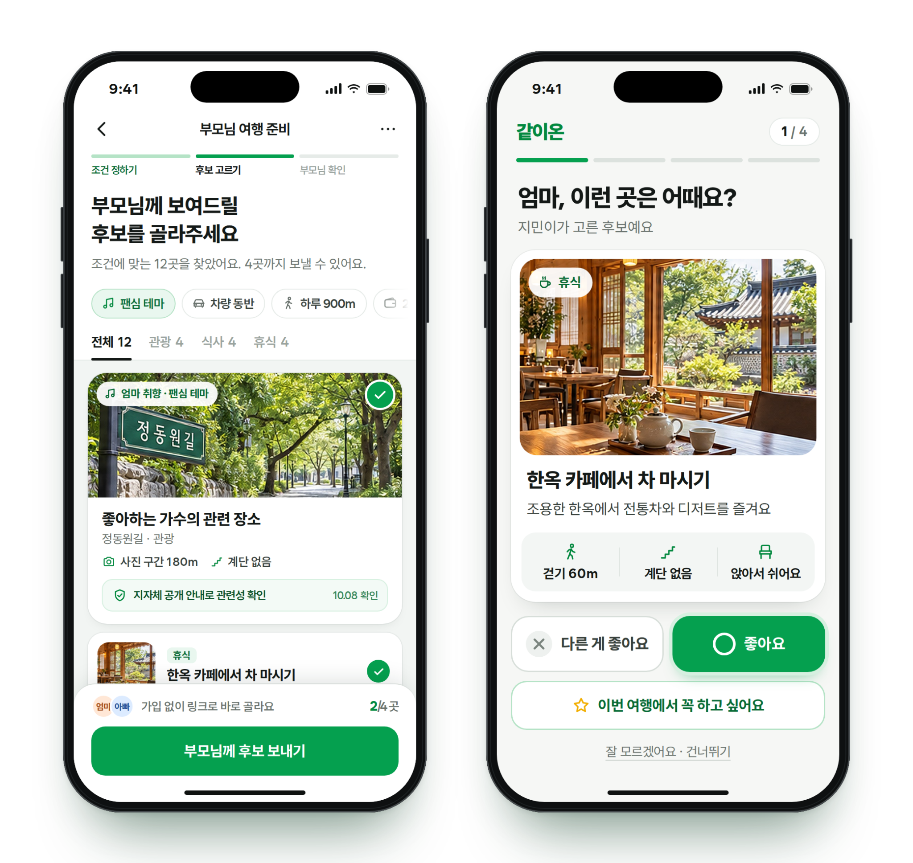
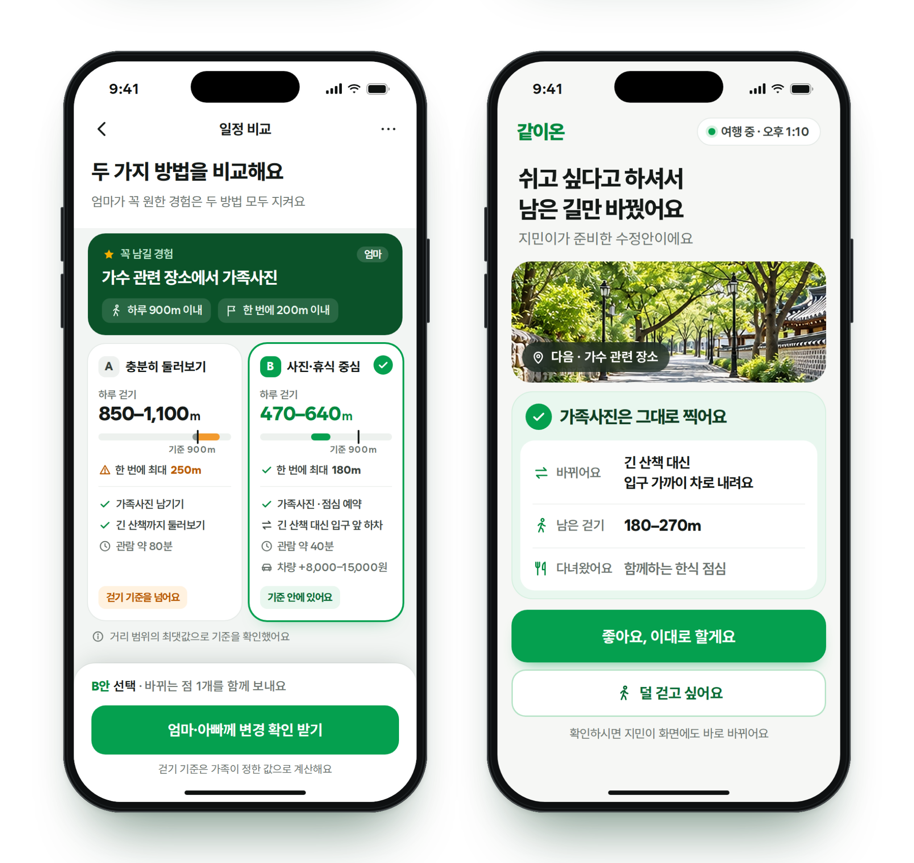
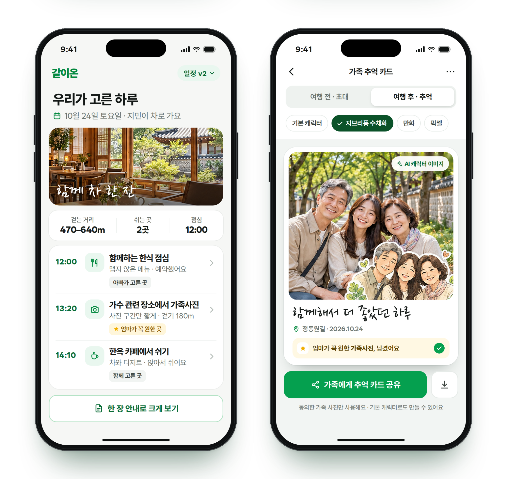

# 같이온 · Family Trip Planner

**자녀가 준비하고, 부모님이 고르는 가족 여행 설계 도우미**

부모님과의 여행을 준비할 때 “어디든 괜찮아”라는 답만으로는 원하는 경험을 알기 어렵다. 같이온은 자녀가 추린 후보에서 부모님이 간단히 선택하고, **그 경험을 남기면서 걷는 방식과 일정을 조정**하는 서비스이다.

## 관련 개발 경험

본 프로젝트의 기획·개발 과정에는 데이터 처리, AI 에이전트, LLM 연동, 클라우드 기반 서비스 개발 등의 경험을 활용하고 있습니다.

| 프로젝트 | 주요 기술 및 개발 경험 |
| --- | --- |
| [FinBridge](https://github.com/start-finance-ai/finbridge-backend) | 지원사업 조건 매칭, 재무 계산, OpenAPI·LLM 연동 및 웹서비스 개발 |
| [금융상품 AI 에이전트](https://github.com/miraero-gaja/backend) | RDF/Turtle 온톨로지, 금융상품 조회 도구, HyperCLOVA X 기반 AI 에이전트 |
| [지원장바구니](https://github.com/yurimakes/youth-policy-llm-recommender) | 청년정책 데이터 수집·정규화, 자격조건 검사, 임베딩 검색·LLM 연동 |
| [CANOPY Data Platform](https://github.com/yurimakes/canopy-data-platform) | Azure·Databricks 기반 데이터 파이프라인, ML 모델 검증, 모바일·관리자 웹 연계 |

현재 저장소는 **아이디어를 사용 흐름과 실행 가능한 코드로 구체화한 초기 프로토타입**이다. 실제 시설 데이터 수집, 외부 AI 연동, 별도 기기 사이의 가족 초대 기능은 후속 개발 범위이다.

## 실행과 공개 데모

```powershell
python -m backend.server
```

`http://127.0.0.1:8000/`을 열고 화면 위쪽의 **예시 상태로 빠르게 체험 → 일정 비교**를 누르면 가족 확인과 확정을 체험할 수 있다. **가족 카드**에서는 직접 고른 사진과 기본 캐릭터로 PNG를 저장한다. 작은 화면은 **자녀 화면 보기 / 부모님 화면 보기**로 전환한다.

공개 링크로 체험할 수 있도록 **GitHub Pages 배포 구성과 Windows·Linux 자동 검증을 준비**했다. 공개 빌드는 가상 데이터로 브라우저에서 실행하며 선택·일정·사진을 서버에 저장하지 않는다. 실제 공개 URL은 최초 배포와 접속 확인 후 추가한다. [배포 방법과 체험 범위](docs/DEPLOYMENT.md)를 참고한다.

Windows에서 로그인된 GitHub CLI가 있다면 `scripts/publish_demo.ps1 -Wait`으로 Pages 설정·배포·실제 URL 접속 확인을 진행할 수 있다. 배포 대상은 앱 설치 없이 링크로 여는 웹 데모이다.

## 확정 앱 디자인

초록색을 중심으로 후보 준비·사진 선택, 대안 비교·변경 확인, 여행 소개·추억 카드의 세 가지 장면을 구성했다. 앱 화면에도 큰 사진 카드, O/X 선택, 나란한 일정 비교, 변경 요약과 소개·추억 카드 구성을 반영했다.

아래 이미지는 **확정 UI 디자인 예시**이다. 이미지 안의 장소 수·거리·날짜·확인 표시·AI 이미지는 화면 설계용이며 실제 시설 검증이나 API 연동 결과를 의미하지 않는다. 실행 코드에서는 가상 데이터의 계산값과 현재 구현 상태를 표시한다.

*이미지를 클릭하면 원본 크기로 확인할 수 있다.*

### 후보 준비 · 부모님 사진 선택

<p align="center">
  <a href="web/assets/design/design-01.png">
    
  </a>
</p>

### 두 가지 대안 비교 · 남은 일정 변경 확인

<p align="center">
  <a href="web/assets/design/design-02.png">
    
  </a>
</p>

### 여행 소개 · 가족 추억 카드

<p align="center">
  <a href="web/assets/design/design-03.png">
    
  </a>
</p>

## 사용 흐름

1. **자녀 설정** — 지역 범위·예산·차량 이동·보행·식사 조건을 정하고 후보를 추린다.
2. **사진 OX** — 부모님별 좋아요·별로예요·건너뛰기와 필수 경험을 기록한다. 직접 선택과 대화 확인을 구분한다.
3. **일정 비교** — 선택한 관람을 더 남기는 A안과 짧은 접근 중심의 B안을 비교한다.
4. **여행 소개** — 두 분의 확인 후 같은 일정 버전으로 방문 이유·식사·휴식을 안내한다.
5. **일정 수정** — 완료한 구간과 식사 예약을 유지하고 남은 구간만 다시 검사한다.
6. **가족 카드** — 기본 캐릭터와 직접 고른 사진으로 초대·추억 카드를 만들고 PNG로 저장한다.

## 지금 구현한 것

| 기능 | 현재 상태 |
| --- | --- |
| 자녀·부모님 모바일 화면, 6단계 이동 | 확정 초록색 디자인 반영. 같은 탭에서 상태 공유. 작은 화면에서 역할 전환 |
| 부모님별 선택·필수 경험·입력 출처 | 구현. 미응답·건너뛰기를 동의로 처리하지 않음 |
| 보행 범위·연속 보행·계단·운영시간·식사·예약·예산 검사 | Python 구현. 정적 체험용 JavaScript에도 같은 규칙 적용 |
| 일정 비교와 가족 확인 후 확정 | 구현. 확인할 조건이 있으면 확정 차단 |
| 완료 구간 유지·남은 구간 재검사·일정 버전 변경 | 구현. 완료한 보행도 하루 합계에 포함 |
| SQLite 저장·조회·수정·삭제, 변경 이력 | 로컬 API 구현. 토큰과 상태 revision 사용 |
| 인쇄용 안내, 사진 합성·기본 캐릭터·PNG 내보내기 | Windows에서 인쇄용 안내 표시·사진 선택·기본/사진 카드 PNG 저장 확인. Web Share는 실행 확인 대기 |
| 공개 데모 빌드·자동 검증·배포 | 전용 정적 빌드와 Windows·Linux Actions 구성. 최초 Pages 설정·공개 URL 확인 대기 |
| FastAPI 어댑터 | 기본 API 테스트 통과. 기본 서버와 같은 서비스 계층 사용. 상세 범위는 [검증 기록](docs/VALIDATION.md) 참고 |
| LLM 입력 해석·후보 설명 | 미연동. 현재 후보 설명은 정해진 예시 문구 |
| 생성형 AI 가족 사진 캐릭터 변환 | 미연동. 기본 캐릭터를 AI 생성 결과로 표시하지 않음 |
| 실제 관광·무장애 정보, 지도·공연·예약 연동 | 미연동. 실제 장소의 접근성·예약 가능성을 보장하지 않음 |
| 별도 기기용 가족 초대 링크·사용자 인증 | 미구현. 현재 두 화면은 이 탭 안의 시연용 역할 화면 |

**모든 장소·구간·거리·시간·비용은 가상 데이터이다.** 초기 데이터는 6개 후보와 12개 이용 방식으로 구성한다. 실제 장소는 출처 URL·확인일·접근 정보와 인물·작품 관계를 확인한 뒤 연결할 예정이다. 실제 제휴를 전제하지 않는다.

첫 서비스 목표는 **한 권역의 차량 동반 당일여행, 부모님 2명·자녀 1명, 후보 12곳·일정 최대 6곳·이용 방식 최대 12개**이다. 경주를 우선 조사하되 필요한 시설 정보를 확보한 뒤 권역을 확정한다. 현재 화면의 후보 최대 4곳 선택은 데모 범위이다. 상세 식성 입력, AI 구조화·근거 추출, 가족 초대 링크, Hugging Face 이미지 변환과 Python 카드 합성은 후속 범위이며 [서비스 범위](docs/PRODUCT.md)에 구분했다.

## 검사 규칙

- 접근·내부 경험·출구의 보행 구간을 합산하고 범위의 **상한**으로 조건을 검사한다.
- 확인된 좌석 휴식은 연속 보행 구간을 나눈다. 휴식으로 하루 총보행을 줄이지 않는다.
- 부모님이 필수로 고른 경험은 짧은 이용 방식에서도 유지한다. 빠지면 확정을 차단한다.
- 선호가 충돌하거나 핵심 접근 정보가 없으면 확인할 항목을 반환한다.
- 수정안은 완료한 구간을 유지하고 남은 구간만 바꾼다. 식사 예약 시간은 자동 변경하지 않는다.
- 서버는 클라이언트가 보낸 검사 결과를 신뢰하지 않고 확정 시 직접 다시 계산한다.

## 구조와 문서

| 경로 | 역할 |
| --- | --- |
| `web/` | UI, 정적 검사 엔진, 가상 장소 데이터와 자체 작성 일러스트 |
| `backend/planner.py` | 후보 선택·일정 생성·조건 검사·남은 구간 수정 |
| `backend/service.py` | 확정 시 재검사와 API 작업 |
| `backend/store.py` | SQLite, 토큰 해시, revision 충돌 검사 |
| `backend/server.py` | 의존성 없는 로컬 HTTP 서버 |
| `backend/fastapi_app.py` | 선택형 ASGI 어댑터 |
| `tests/` | 규칙·저장·HTTP·프런트엔드 상태·Python/JS 결과 일치 검사 |
| [서비스 범위](docs/PRODUCT.md) | 사용 장면, 데이터와 다음 구현 범위 |
| [기술 설계](docs/ARCHITECTURE.md) | AI와 코드 검사의 역할, 현재 구성 |
| [API](docs/API.md) | 엔드포인트와 확인·변경 요청 |
| [검증 기록](docs/VALIDATION.md) | 실행한 검사와 확인하지 못한 범위 |
| [데모 배포](docs/DEPLOYMENT.md) | 공개/로컬 체험 차이, 빌드, Pages 최초 설정과 자동 배포 |

## 검증 현황

최신 [GitHub Actions 검사](https://github.com/yurimakes/family-trip-planner/actions/runs/38335110122)에서 **Windows·Linux 각각 Python 43개와 JavaScript 5개 모두 통과**했다. 선택형 FastAPI 검사도 포함하며 건너뛴 테스트는 없다. 공개 파일 51개 검사에서 발견 사항 0건, 공개 데모 19개 파일 빌드도 두 환경에서 통과했다. Windows PowerShell 게시 스크립트의 응답 대체 검사 8개도 통과했다.

Windows 브라우저에서 두 화면의 일정 v1, 헤더, 남은 일정 수정안, 인쇄용 안내 표시, 선택한 이미지의 카드 반영과 900×1120 PNG 저장을 확인했다. 사진 이용 동의 해제 시 이미지 삭제는 사용자 확인을 마쳤다. 실제 모바일 화면·Web Share 실행은 아직 확인하지 않았다. 상세 범위는 [검증 기록](docs/VALIDATION.md)에 정리했다.

## 데이터와 개인정보

프로토타입은 가상 장소와 익명 역할 `mom`·`dad`를 사용한다. 사진과 카드 기록은 외부 서비스에 전송하지 않는다. API에는 예산·조건·선택만 저장하고 사진·실명·연락처 필드는 받지 않는다. 서버의 여행 토큰은 해시로 저장한다.

현재 API는 **개발용 로컬 서버**이다. 부모님별 인증, 권한 분리, 운영 환경의 접근 제한·속도 제한·보관 정책은 후속 구현이다. 확인 기록은 이 탭에서 사용자가 입력한 기록이며 별도 인물 인증을 의미하지 않는다.

## 디자인 자산

확정 UI PNG 3장과 앱의 사진 영역은 디자인 예시로 사용한다. 실제 장소의 접근성이나 관련 인물·작품의 관계를 사진만으로 확인하지 않는다. 앱 글꼴은 [SUIT](https://github.com/sun-typeface/SUIT)를 로컬 파일로 포함하며, [SIL Open Font License](web/assets/fonts/OFL.txt)를 함께 제공한다.
