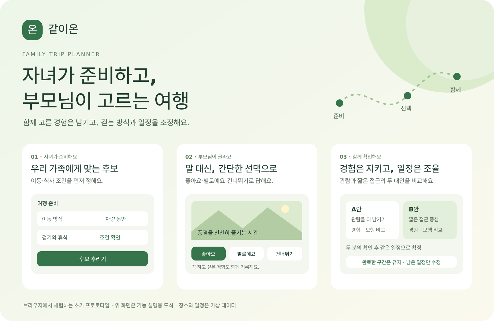

# 같이온 · Family Trip Planner

**자녀가 준비하고, 부모님이 고르는 가족 여행 설계 도우미**

부모님과 여행을 준비할 때, “어디든 괜찮아”라는 답만으로는 원하는 경험을 알기 어렵습니다. 같이온은 **자녀가 후보를 준비하고, 부모님이 간단히 선택한 뒤, 가족이 함께 일정을 확인**하는 서비스입니다. 함께 고른 경험을 남기면서 걷는 방식과 휴식, 식사 조건을 조율합니다.

[](https://yurimakes.github.io/family-trip-planner/)

<p align="center">
  <a href="https://yurimakes.github.io/family-trip-planner/"><b>같이온 웹 데모 체험하기 ↗</b></a>
  &nbsp; · &nbsp;
  <a href="#빠르게-체험하기">체험 안내</a>
  &nbsp; · &nbsp;
  <a href="docs/PRODUCT.md">서비스 범위</a>
</p>

> 설치 없이 브라우저에서 열 수 있는 **초기 프로토타입**입니다. 소개 이미지의 화면은 기능 설명용 도식입니다. 공개 데모의 장소·거리·시간·비용은 가상 데이터이며, 외부 AI·지도·예약 서비스는 아직 연결하지 않았습니다.

## 관련 개발 경험

본 프로젝트의 기획·개발 과정에는 데이터 처리, AI 에이전트, LLM 연동, 클라우드 기반 서비스 개발 등의 경험을 활용하고 있습니다.

| 프로젝트 | 주요 기술 및 개발 경험 |
| --- | --- |
| [FinBridge](https://github.com/start-finance-ai/finbridge-backend) | 지원사업 조건 매칭, 재무 계산, OpenAPI·LLM 연동 및 웹서비스 개발 |
| [금융상품 AI 에이전트](https://github.com/miraero-gaja/backend) | RDF/Turtle 온톨로지, 금융상품 조회 도구, HyperCLOVA X 기반 AI 에이전트 |
| [지원장바구니](https://github.com/yurimakes/youth-policy-llm-recommender) | 청년정책 데이터 수집·정규화, 자격조건 검사, 임베딩 검색·LLM 연동 |
| [CANOPY Data Platform](https://github.com/yurimakes/canopy-data-platform) | Azure·Databricks 기반 데이터 파이프라인, ML 모델 검증, 모바일·관리자 웹 연계 |

## 어떤 여행을 돕나요?

장소를 많이 찾는 것보다 **부모님이 원하는 경험과 편하게 이동할 수 있는 조건을 함께 맞추는 일**에 집중합니다.

| 여행을 준비하며 생기는 고민 | 같이온의 사용 방식 |
| --- | --- |
| “어디든 괜찮아”라는 답으로는 취향을 알기 어려워요. | 사진 후보에서 좋아요·별로예요·건너뛰기로 선택합니다. 부모님별 필수 경험도 기록합니다. |
| 덜 걷게 하면 기대했던 관람까지 빠질까 걱정돼요. | 관람을 더 남기는 A안과 짧은 접근 중심의 B안을 비교하고, 필수 경험이 빠지면 확정을 막습니다. |
| 여행 중 피곤해지면 전체 일정을 다시 짜야 하나요? | 완료한 구간과 식사 예약은 유지하고, 남은 구간만 조건을 다시 검사합니다. |
| 가족이 같은 일정으로 이해하고 있는지 확인하고 싶어요. | 부모님 두 분의 확인 후 확정하고, 같은 일정 버전으로 여행을 안내합니다. |

## 빠르게 체험하기

1. **[웹 데모 열기](https://yurimakes.github.io/family-trip-planner/)** → 화면 위쪽 **예시 상태로 빠르게 체험**에서 **일정 비교**를 누릅니다.
2. **부모님 화면**에서 두 분의 확인을 입력하고, **자녀 화면**에서 일정을 확정해 보세요.
3. **일정 수정**에서 남은 구간을 조율하거나, **가족 카드**에서 직접 고른 사진과 기본 캐릭터로 PNG를 저장해 보세요.

작은 화면에서는 **자녀 화면 보기 / 부모님 화면 보기**로 전환합니다. 두 화면은 **같은 탭의 상태를 공유하는 시연용 화면**입니다. 별도 기기 사이의 가족 초대 기능은 후속 개발 범위입니다.

공개 데모는 선택·일정·사진을 서버에 저장하지 않으며, 새로고침하면 처음부터 시작합니다. [공개 데모와 로컬 실행의 차이](docs/DEPLOYMENT.md)를 확인할 수 있습니다.

## 함께 준비하는 여섯 단계

| ① 자녀 설정 | ② 사진 OX | ③ 일정 비교 |
| --- | --- | --- |
| 지역·예산·이동·보행·식사 조건으로 후보를 추립니다. | 부모님별 선택과 필수 경험을 기록합니다. | 경험과 보행 조건을 함께 보고 A/B안을 비교합니다. |

| ④ 여행 소개 | ⑤ 일정 수정 | ⑥ 가족 카드 |
| --- | --- | --- |
| 가족 확인 후 방문 이유·식사·휴식을 안내합니다. | 완료한 구간을 유지하고 남은 일정만 다시 검사합니다. | 기본 캐릭터와 직접 고른 사진으로 초대·추억 카드를 저장합니다. |

<details>
<summary><b>앱 디자인 자세히 보기 — 준비와 선택 / 비교와 조율 / 소개와 추억</b></summary>

초록색, 큰 사진 카드, 간단한 선택, 나란한 일정 비교를 중심으로 구성한 **확정 UI 디자인 예시**입니다. 아래 수치·날짜·확인 표시·AI 이미지는 화면 설계용이며 실제 시설 검증이나 API 연동 결과를 의미하지 않습니다. 이미지를 클릭하면 원본을 볼 수 있습니다.

<table>
<tr><th>후보 준비 · 사진 선택</th><th>대안 비교 · 변경 확인</th><th>여행 소개 · 추억 카드</th></tr>
<tr>
<td><a href="web/assets/design/design-01.png"></a></td>
<td><a href="web/assets/design/design-02.png"></a></td>
<td><a href="web/assets/design/design-03.png"></a></td>
</tr>
</table>

</details>

## 현재 구현 범위

| 지금 체험할 수 있는 기능 | 후속 개발 범위 |
| --- | --- |
| 자녀·부모님 화면, 부모님별 선택·필수 경험 기록 | 별도 기기용 가족 초대 링크와 사용자 인증 |
| 보행·계단·운영시간·식사·예약·예산 조건 검사 | 실제 관광·무장애 정보 수집, 지도·공연·예약 연동 |
| A/B 일정 비교, 가족 확인 후 확정, 남은 구간 수정 | LLM 입력 해석과 근거를 갖춘 후보 설명 |
| 기본 캐릭터·직접 고른 사진의 카드 PNG 저장 | 생성형 AI를 이용한 가족 사진 캐릭터 변환 |
| 로컬 SQLite API와 변경 이력, FastAPI 어댑터 | 운영 환경의 권한 분리·접근 제한·보관 정책 |

미응답과 건너뛰기를 동의로 바꾸지 않습니다. 필수 경험이 빠지거나 확인할 핵심 조건이 남으면 확정을 막고, 서버에서도 조건을 다시 계산합니다.

첫 서비스 목표는 **한 권역의 차량 동반 당일여행, 부모님 2명·자녀 1명**입니다. 현재 데모는 가상 후보 6개·이용 방식 12개로 구성하며 후보를 최대 4곳 선택합니다. 실제 서비스는 후보 12곳·일정 최대 6곳·이용 방식 최대 12개를 목표로 하고, 경주를 우선 조사하되 시설 정보를 확보한 뒤 권역을 확정합니다. [상세 서비스 범위](docs/PRODUCT.md)

## 로컬에서 실행하기

```powershell
python -m backend.server
```

저장소 루트에서 실행한 뒤 `http://127.0.0.1:8000/`을 엽니다. 로컬 서버는 Python 검사 엔진과 SQLite API를 사용합니다. 공개 웹 데모는 브라우저의 JavaScript 검사 엔진으로 동작합니다.

<details>
<summary><b>개발 상세 — 검사 규칙 · 코드 구조 · 검증 · 개인정보</b></summary>

## 검사 규칙

- 접근·내부 경험·출구의 보행 구간을 합산하고 범위의 **상한**으로 조건을 검사한다.
- 확인된 좌석 휴식은 연속 보행 구간을 나눈다. 휴식으로 하루 총보행을 줄이지 않는다.
- 부모님이 필수로 고른 경험은 짧은 이용 방식에서도 유지한다. 빠지면 확정을 차단한다.
- 선호가 충돌하거나 핵심 접근 정보가 없으면 확인할 항목을 반환한다.
- 수정안은 완료한 구간을 유지하고 남은 구간만 바꾼다. 식사 예약 시간은 자동 변경하지 않는다.
- 서버는 클라이언트가 보낸 검사 결과를 신뢰하지 않고 확정 시 직접 다시 계산한다.

## 구조와 문서

| 경로 | 역할 |
| --- | --- |
| `web/` | UI, 정적 검사 엔진, 가상 장소 데이터와 자체 작성 일러스트 |
| `backend/planner.py` | 후보 선택·일정 생성·조건 검사·남은 구간 수정 |
| `backend/service.py` | 확정 시 재검사와 API 작업 |
| `backend/store.py` | SQLite, 토큰 해시, revision 충돌 검사 |
| `backend/server.py` | 의존성 없는 로컬 HTTP 서버 |
| `backend/fastapi_app.py` | 선택형 ASGI 어댑터 |
| `tests/` | 규칙·저장·HTTP·프런트엔드 상태·Python/JS 결과 일치 검사 |
| [서비스 범위](docs/PRODUCT.md) | 사용 장면, 데이터와 다음 구현 범위 |
| [기술 설계](docs/ARCHITECTURE.md) | AI와 코드 검사의 역할, 현재 구성 |
| [API](docs/API.md) | 엔드포인트와 확인·변경 요청 |
| [검증 기록](docs/VALIDATION.md) | 실행한 검사와 확인하지 못한 범위 |
| [데모 배포](docs/DEPLOYMENT.md) | 공개/로컬 체험 차이, 빌드, Pages 최초 설정과 자동 배포 |

## 검증 현황

최신 [GitHub Actions 검사](https://github.com/yurimakes/family-trip-planner/actions/runs/38335110122)에서 **Windows·Linux 각각 Python 43개와 JavaScript 5개 모두 통과**했다. 선택형 FastAPI 검사도 포함하며 건너뛴 테스트는 없다. 공개 파일 51개 검사에서 발견 사항 0건, 공개 데모 19개 파일 빌드도 두 환경에서 통과했다. Windows PowerShell 게시 스크립트의 응답 대체 검사 8개도 통과했다.

Windows 브라우저에서 두 화면의 일정 v1, 헤더, 남은 일정 수정안, 인쇄용 안내 표시, 선택한 이미지의 카드 반영과 900×1120 PNG 저장을 확인했다. 사진 이용 동의 해제 시 이미지 삭제는 사용자 확인을 마쳤다. 실제 모바일 화면·Web Share 실행은 아직 확인하지 않았다. 상세 범위는 [검증 기록](docs/VALIDATION.md)에 정리했다.

## 데이터와 개인정보

프로토타입은 가상 장소와 익명 역할 `mom`·`dad`를 사용한다. 사진과 카드 기록은 외부 서비스에 전송하지 않는다. API에는 예산·조건·선택만 저장하고 사진·실명·연락처 필드는 받지 않는다. 서버의 여행 토큰은 해시로 저장한다.

현재 API는 **개발용 로컬 서버**이다. 부모님별 인증, 권한 분리, 운영 환경의 접근 제한·속도 제한·보관 정책은 후속 구현이다. 확인 기록은 이 탭에서 사용자가 입력한 기록이며 별도 인물 인증을 의미하지 않는다.

## 디자인 자산

확정 UI PNG 3장과 앱의 사진 영역은 디자인 예시로 사용한다. 실제 장소의 접근성이나 관련 인물·작품의 관계를 사진만으로 확인하지 않는다. 앱 글꼴은 [SUIT](https://github.com/sun-typeface/SUIT)를 로컬 파일로 포함하며, [SIL Open Font License](web/assets/fonts/OFL.txt)를 함께 제공한다.


</details>
