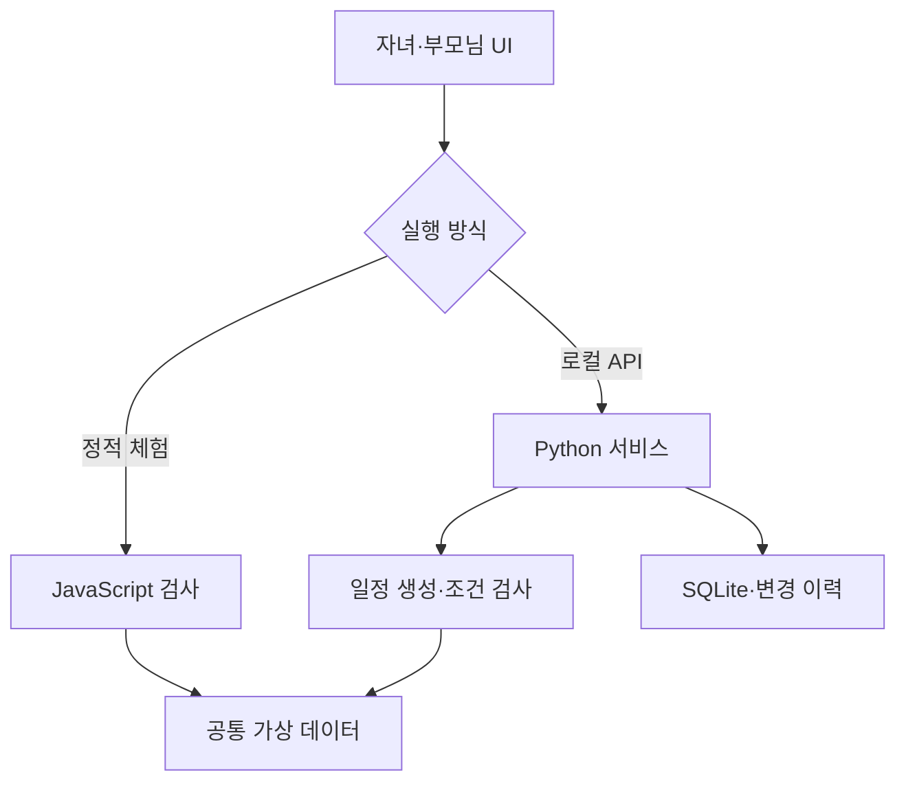

# 기술 설계

현재 구현은 LLM 없이도 핵심 조건과 변경 흐름을 검증할 수 있도록 구성했다.

브라우저 체험은 `web/planner.js`로 계산한다. 로컬 API 모드의 확정 결과는 서버에서 다시 계산한다. 두 엔진은 같은 `catalog.json`을 읽고 공통 회귀 시나리오의 전체 결과를 비교한다. 프런트엔드가 보내는 `valid` 값을 서버의 확정 근거로 사용하지 않는다.

## 데이터와 계산

장소에는 관광·식사·휴식 구분, 운영시간, 접근 확인 상태, 경험과 두 가지 이용 방식이 있다. 이용 방식에는 입구 접근·내부 경험·출구 연결 구간의 보행 범위, 좌석 휴식 여부, 시간·비용·계단 여부가 있다.

일정 A는 선택한 관광 경험을 더 남기고 B는 필수 경험을 우선하며 짧은 이용 방식을 사용한다. 식사와 휴식은 두 분이 함께 좋아한 후보에서 고른다. 서로 다른 식사 후보를 각각 필수로 고른 경우 하나를 조용히 버리지 않고 누락으로 차단한다.

보행 범위는 합산하고 조건 검사는 상한을 사용한다. 좌석 휴식과 차량 이동은 연속 보행을 나누지만 총보행은 차감하지 않는다. 가상 데이터는 장소 사이 보행 연결이 없는 차량 이동을 전제한다. 실제 자료에는 주차·하차·환승·대기와 보행 연결을 별도로 확인해야 한다.

## 상태와 저장

`draft`는 후보, 부모님별 응답·필수 경험·출처, 조건과 미확인 장소를 담는다. `revision`은 서버 상태의 충돌 방지 번호이다. `version`은 가족이 확인한 일정 버전이다. 설정이나 선택이 바뀌면 확정과 동의를 초기화한다.

확정·수정 시 두 부모의 명시적인 확인 기록이 필요하다. SQLite는 쓰기 트랜잭션 안에서 revision을 검사한다. 남은 구간 수정은 완료한 일정의 순서 있는 앞부분만 허용하며, 이미 완료한 구간을 되돌리지 않는다.

여행 접근 토큰은 생성 시 한 번 반환하고 서버에는 SHA-256 해시를 저장한다. 프런트엔드는 토큰을 메모리에서만 유지한다. 토큰을 URL·로그·사진·Git에 기록하지 않는다. 서버를 재시작해도 SQLite 기록은 유지되지만 화면을 새로고침하면 현재 메모리 토큰은 사라진다. 별도 복구 UI는 후속 범위이다.

## AI 연결 경계

| 대상 | 담당 |
| --- | --- |
| 자연어 조건을 구조화하고 확인 질문·후보 설명 작성 | 후속 LLM 연동 |
| 보행 합산, 시간·예약·예산·필수 경험 검사 | 현재 Python 코드 |
| 장소·접근·테마 관계의 출처 확인 | 후속 데이터 수집·검증 |
| 가족 사진을 캐릭터로 변환 | 후속 이미지 생성 API |
| 기본 캐릭터와 사진 합성·PNG 내보내기 | 현재 브라우저 코드 |

실제 AI 키를 프런트엔드에 배치하지 않는다. 외부 AI가 응답을 생성해도 불확실한 정보와 가족 확인을 건너뛰어 일정을 확정하지 않는다.

## 서버 선택

기본 서버는 Python 표준 라이브러리로 동작한다. 선택형 FastAPI 어댑터는 같은 `Service`·`Store`·검사 엔진을 사용한다. API 요청은 사진 없이 64 KiB 이하 JSON을 받으며 로컬 실행을 기본으로 한다. 운영용 사용자 인증과 공개 서버 배포는 아직 구현하지 않았다.
